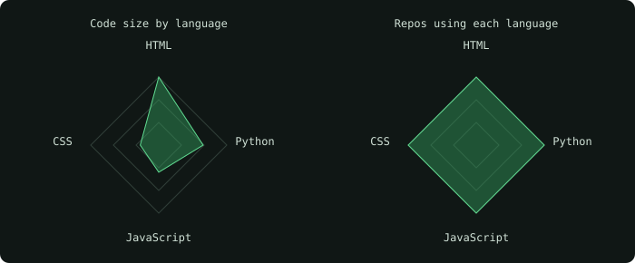
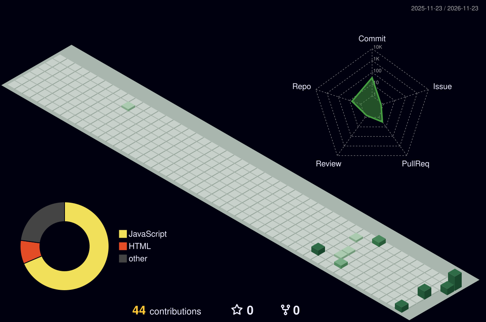
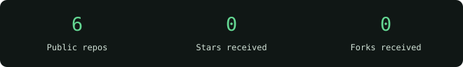

<p align="center">
  
</p>

<p align="center">
  
</p>

<p align="center">
  <a href="https://github.com/arpandas-ship-it?tab=repositories"></a>
  <a href="https://github.com/arpandas-ship-it/HireLabs-Platform"></a>
  <a href="https://github.com/arpandas-ship-it/EADS"></a>
</p>

## ~/ whoami

```console
$ cat about.txt
```

Hi, I’m **Arpan Das**, a Computer Science and Engineering student at **Adamas University, Kolkata**. I build web apps and backend systems. Two problems I’ve worked on are finding evidence for a skill in a résumé and deciding which ambulance to dispatch when requests compete.

- [HireLabs](https://github.com/arpandas-ship-it/HireLabs-Platform) matches résumés to job requirements and highlights skill gaps.
- [Emergency Ambulance Dispatch System](https://github.com/arpandas-ship-it/EADS) tracks an emergency request from verification through dispatch and completion.
- [Student Progress Tracker](https://github.com/arpandas-ship-it/Student-Progress-Tracker-) is another of my public projects.

## ~/ toolbox


## ~/ skill radar



## ~/ contribution calendar



## ~/ the numbers


